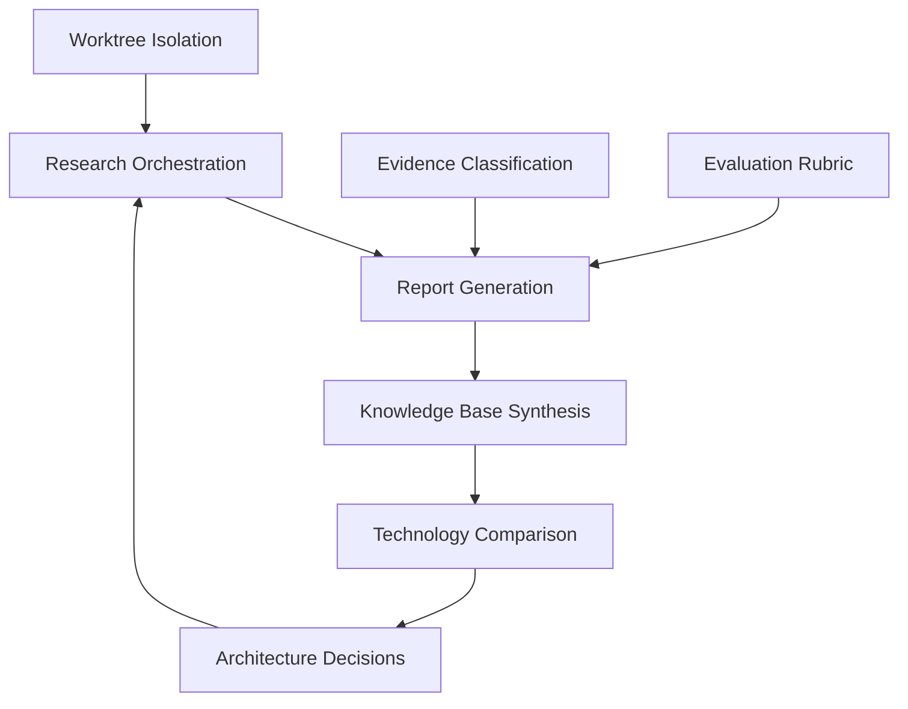

# Features — Project Atlas

## Core features (high priority)

| ID | Feature | Description | Priority |
|----|---------|-------------|----------|
| F-01 | Multi-domain research orchestration | Coordinates independent research across multiple domains in parallel | High |
| F-02 | Git-worktree agent isolation | Each research agent works in an isolated worktree on its own branch | High |
| F-03 | Research report generation | Agents produce structured Markdown reports with sources | High |
| F-04 | Evidence classification | Claims classified as FACT / INTERPRETATION / HYPOTHESIS / PROPOSAL | High |
| F-05 | Knowledge base synthesis | Manager combines approved reports into docs/knowledge-base/ | High |
| F-06 | Technology comparison matrix | Compares frameworks, languages, libraries across criteria | High |
| F-07 | Architecture decision records | Documents reasoning, alternatives, and evidence for each decision | High |
| F-08 | Evaluation rubric | LLM-as-judge + human review gate for research-report quality | Medium |

## Future features (low priority — not in initial scope)

| ID | Feature | Description | Priority |
|----|---------|-------------|----------|
| F-09 | MCP server integration | Agents access tools via Model Context Protocol | Low |
| F-10 | Automated cost measurement | Real token-cost tracking per research cycle | Low |
| F-11 | CLI interface | Command-line interface for running research cycles | Low |
| F-12 | Test suite | Automated tests for orchestrator and components | Medium |

## Feature relationships

