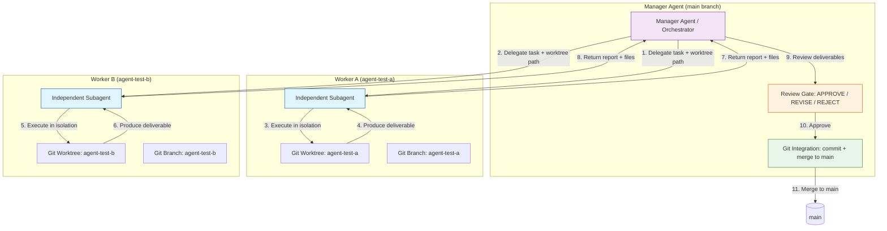

# Agent Execution Architecture — Project Atlas

## Overview

Project Atlas uses an orchestrator-worker pattern with Git worktree-based agent isolation. The Manager Agent (orchestrator) runs on `main` and delegates independent work to subagents, each operating in an isolated Git worktree on its own branch. All Git integration (commit, merge) is performed exclusively by the Manager Agent.

## Architecture Diagram (Mermaid)

## Core Principles

| Principle | Description |
|-----------|-------------|
| Manager owns `main` | Only the Manager Agent commits, merges, or pushes. Workers never touch `main`. |
| One branch per worker | Each worker receives a dedicated Git branch (e.g., `agent-test-a`, `agent-test-b`). |
| One worktree per worker | Each worker receives an isolated physical working directory (Git worktree) on its branch. |
| Workers own only their worktree | Workers cannot modify other worktrees, `main`, or shared files outside their assignment. |
| Manager performs Git integration | After review, the Manager stages, commits, and merges approved worker deliverables. |

## Delegation Flow

1. **Manager creates branch and worktree** — `git branch <name> main` then `git worktree add <path> <branch>`.
2. **Manager assigns task** — Worker receives a detailed prompt including branch name, worktree path, objective, deliverables, restrictions, and completion criteria.
3. **Worker executes independently** — Agent works inside its worktree, produces deliverable files, does not commit.
4. **Worker returns report** — Agent submits findings and file list in its response.
5. **Manager reviews** — Manager inspects actual files in the worktree, verifies deliverables meet criteria.
6. **Manager commits** — Manager stages approved files on the worker's branch and commits.
7. **Manager merges** — Manager merges the approved branch into `main`.

## Verified Evidence (Phase 6.2)

| Verification Point | Result | Evidence |
|--------------------|--------|----------|
| Independent agent contexts | Verified | Two `task` tool calls returned separate session IDs with successful results |
| Different Git branches | Verified | Worker A: `agent-test-a`; Worker B: `agent-test-b` |
| Different worktree paths | Verified | Worker A: `.../agent-test-a/`; Worker B: `.../agent-test-b/` |
| Workspace isolation | Verified | Each agent accessed only its assigned worktree path |
| Independent task completion | Verified | Both agents completed without Manager intervention during execution |
| Actual file changes | Verified | Worker A: `docs/04-implementation/agent-a-module-inspection.md` (86 lines); Worker B: `tests/test_state_independent.py` + `docs/06-testing/worker-b-test-result.md` (68 lines) |
| Returned reports | Verified | Both agents returned completion reports with file paths and results |
| Manager review and integration | Verified | Manager inspected files, committed on worker branches, merged to `main` |

## Limitations Observed

- Earlier `task` tool calls appeared to abort on real assignments, but subsequent tests confirmed delegation works — aborts were transient
- Workers cannot commit/merge/push; Git integration remains exclusively Manager-owned
- Workers cannot access other worktrees or `main` by design

## Decision

**REAL DELEGATION VERIFIED** — Independent agents can execute work reliably in isolated Git worktrees on dedicated branches, return deliverables, and have their work reviewed and integrated by the Manager Agent.

## Sources

- Phase 6.2 delegation test: Worker A (ses_e6e94da46ffeRY0H6iUlmoRPvg), Worker B (ses_e6e94c9ddffeSZGpHrQgGjO459)
- Worker A deliverable: `docs/04-implementation/agent-a-module-inspection.md`
- Worker B deliverable: `tests/test_state_independent.py`, `docs/06-testing/worker-b-test-result.md`
