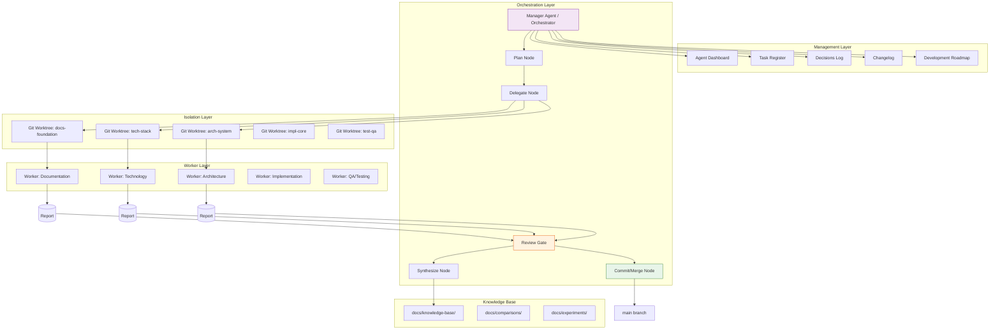

# Component Architecture — Project Atlas

## Component diagram (Mermaid)

## Component responsibilities

| Component | Responsibility | Inputs | Outputs |
|-----------|---------------|--------|---------|
| Manager Agent | Orchestrates the research cycle; creates branches/worktrees; reviews deliverables; commits/merges | Research objective; worker reports | Branches; worktrees; merged main; knowledge base |
| Plan Node | Decomposes objective into independent domains | Objective | Domain list |
| Delegate Node | Creates branch + worktree per domain | Domain list | Branch names; worktree paths |
| Worker | Executes assigned task in isolated worktree | Assignment prompt | Deliverable (report/code) |
| Review Gate | Human-in-the-loop: APPROVED / REVISION REQUIRED / REJECTED | Worker deliverable | Decision |
| Synthesize Node | Combines approved reports into knowledge base | Approved reports | docs/knowledge-base/ entries |
| Commit/Merge Node | Merges approved branches into main | Approved branch | Updated main |
| Git worktree | Isolated working directory per domain | Branch | Working files |
| Knowledge base | Centralized synthesized findings | Approved reports | Structured documentation |

## Inter-component communication

- **Manager ↔ Workers**: Through assignment prompts and worktrees (no direct process communication; workers operate independently).
- **Workers → Manager**: Through deliverable files placed in their worktrees.
- **Manager → Git**: Through commits and merges on branches/worktrees.
- **Manager → Knowledge base**: Through synthesized documentation files.

## Data ownership

- **Worktrees**: Owned by the worker assigned to that domain; no other worker may modify.
- **main branch**: Owned exclusively by the Manager Agent.
- **docs/**: Shared documentation; updated by workers in their domain and by the Manager during integration.
- **src/**: Application source code (planned); owned by implementation workers.
