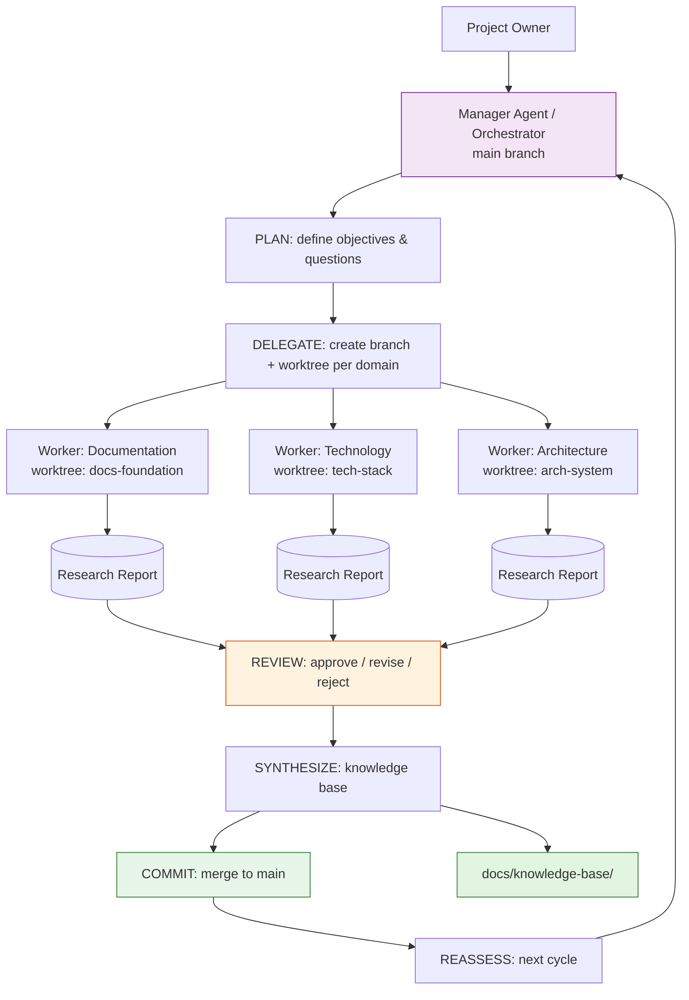

# System Architecture — Project Atlas

## Overview

Project Atlas is a multi-agent research and exploration orchestrator. Its core responsibility is to coordinate independent research agents across multiple domains, synthesize their findings into a centralized knowledge base, and guide incremental implementation of the project it helps design.

## Architectural pattern

Atlas uses the **orchestrator-worker pattern** with **git-worktree agent isolation**:

- A lead agent (orchestrator / Manager Agent) decomposes a research objective into independent domains.
- Each domain is assigned to a worker agent operating in an isolated Git worktree on its own branch.
- Workers produce research reports; the orchestrator synthesizes approved reports into the knowledge base.
- All integration (commits, merges) is performed by the Manager Agent on `main`.

## High-level architecture (Mermaid)

## System boundaries

**In scope:**
- Research orchestration (plan → delegate → investigate → report → review → synthesize → commit → reassess)
- Git-worktree agent isolation
- Research report generation with evidence classification (FACT / INTERPRETATION / HYPOTHESIS / PROPOSAL)
- Knowledge base synthesis
- Technology and architecture comparison documentation
- Evaluation rubric (LLM-as-judge + human review)
- Management documentation (dashboard, task register, decisions, changelog)

**Out of scope:**
- General-purpose LLM chatbot
- Web search engine or crawler
- Autonomous code generation for arbitrary applications
- Deployment/DevOps platform
- User authentication or multi-tenancy

## Component responsibilities

| Component | Responsibility |
|-----------|---------------|
| Manager Agent (Orchestrator) | Coordinates cycles, creates branches/worktrees, assigns tasks, reviews deliverables, commits/merges to main |
| Worker Agents | Execute assigned research/implementation in isolated worktrees, produce deliverables |
| Git worktrees | Filesystem isolation per domain; each on its own branch |
| Knowledge base (docs/knowledge-base/) | Synthesized findings from approved reports |
| Management docs (docs/09-management/) | Dashboard, task register, decisions, changelog, roadmap |
| Source code (src/) | Application implementation (planned, not yet built) |
| Tests (tests/) | Test suite (planned, not yet built) |

## Data flow

1. Owner submits a research objective to the Manager Agent.
2. Manager decomposes the objective into independent domains.
3. Manager creates a Git branch and worktree per domain.
4. Workers execute research in isolation, producing reports.
5. Manager reviews each report (APPROVED / REVISION REQUIRED / REJECTED).
6. Approved reports are synthesized into docs/knowledge-base/.
7. Manager merges approved branches into main.
8. Cycle reassesses and plans the next investigation.
