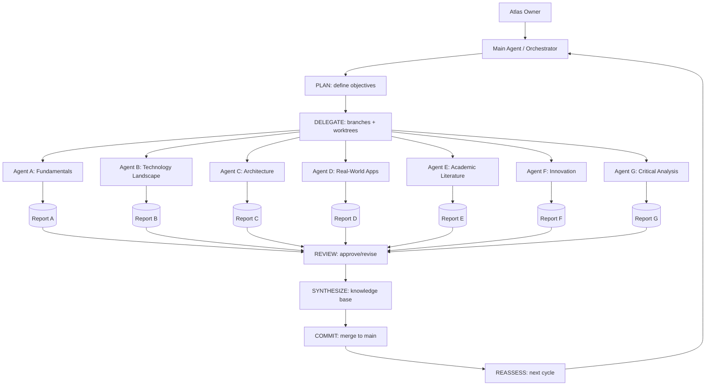

# Agent C Report — System Architecture

## Orchestration Pattern Catalog

| Pattern | How it works | Best for | Watch out for | Complexity | Atlas suitability |
|---------|-------------|----------|---------------|------------|-------------------|
| Orchestrator-Worker | Lead agent decomposes task, delegates to parallel workers, synthesizes results | Research with many independent directions | Coordinator bottleneck; workers can't coordinate directly | Medium | High — fits Atlas cycle |
| Sequential / Pipeline | Linear chain; each agent processes previous output | Data processing, deterministic pipelines | Inflexible; hard to debug long chains; "telephone game" fidelity loss | Low | Medium — only for fixed phases |
| Hierarchical | Top-down decomposition; parent delegates to domain subagents | Modularity, independent ownership, reuse | Over-engineering for simple flows | Medium | High — Atlas management layer |
| Coordinator / Dispatcher (Concierge) | Central intelligent agent routes requests to specialists | Customer service, routing | LLM-driven delegation can be unreliable | Medium | Medium — Atlas intake |
| Handoff (Peer-to-Peer) | Agent calls tool returning another agent; runtime switches active agent; no central coordinator | Peer collaboration | No central oversight; hard to trace | Medium-High | Low-Medium — research needs oversight |
| Group Chat | Multiple agents in managed conversation; central chat manager coordinates | Brainstorming, unstructured exploration | Unbounded conversation, cost, lack of structure | High | Low — too unstructured for research |
| Swarm | Lightweight routine agent handoffs | Simple routines | Limited features, framework-bound | Low | Low |

## Centralized vs Decentralized Orchestration

| Dimension | Centralized (orchestrator) | Decentralized (P2P/handoff) |
|-----------|---------------------------|----------------------------|
| Coordination | Single point; clear ownership | Distributed; complex |
| Bottleneck | Orchestrator is bottleneck | No single bottleneck |
| Complexity | Simpler to reason about | Higher complexity |
| Failure modes | Orchestrator failure stops all | Partial failure possible |
| Atlas fit | Better — research needs oversight & synthesis | Worse — synthesis needs a center |

**Source:** Azure AI Agent design patterns, 2026-02-12; MDPI survey, 2026-06-01; HLD Handbook, 2026-05-11.

## Integration Patterns

| Pattern | What it does | Pros | Cons | Atlas relevance |
|---------|-------------|------|------|-----------------|
| MCP | Standard client-server for tools/context | Open, decoupled | Early stage | High |
| A2A | Inter-agent messaging | Standardized, framework-agnostic | Very early | Medium-High |
| REST APIs | Request/response integration | Universal, simple | Synchronous, polling | Medium |
| Message queues | Async event-driven integration | Decoupled, scalable | Infra overhead | Medium-Low |
| Shared state / session state | Agents read/write shared state | Simple coordination | Contention, consistency | High — cycle state |
| Tool exposure | Agents call exposed functions | Direct, typed | Tight coupling | High |

## Scalability Analysis

**Parallelization limits:** Not all tasks parallelize. Anthropic notes most coding tasks involve fewer truly parallelizable tasks than research; research benefits from parallel independent directions — good for Atlas.

**Context-window bounds:** Each agent has bounded context; long research threads risk context loss. Mitigation: summarize, hand off with references, persistent knowledge base.

**Token cost:** Multi-agent systems use ~15× more tokens than single chats; agents ~4× more than chat. Cost scales with agent count and turns.

**Latency:** Sequential phases add latency; parallel workers reduce wall-clock but increase total token spend.

**Long-running workflows:** Need persistence/checkpoints (LangGraph), resume capability, and state durability.

**Debugging:** Multi-agent traces are DAGs, not trees — harder to debug than single-agent traces.

**Sources:** Anthropic Engineering 2025-06-13; HLD Handbook 2026-05-11; Azure AI patterns 2026-02-12.

## Modularity Analysis

**Independent research paths (context-centric):** Each agent works autonomously on an independent domain with minimal coordination. Lets agents explore in parallel; minimal handoff fidelity loss. Best for Atlas cycle 1 (broad discovery).

**Role-centric (planner/implementer/tester/reviewer):** Creates a "telephone game" where handoffs lose fidelity every hop. Avoid for research; suitable only for linear implementation pipelines.

**Recommendation:** Atlas cycle 1 = independent research paths (context-centric). Later cycles may introduce role-centric phases for implementation.

**Source:** HLD Handbook, 2026-05-11.

## Deployment Approaches

| Approach | Description | Pros | Cons | Atlas fit |
|----------|-------------|------|------|-----------|
| Local CLI + git worktrees | CLI tool spawns worktrees per domain; agents work in isolated dirs | Simple, no infra, matches isolation model | Single machine, CLI-only | High — current model |
| Containerized | Each agent/domain in a container | Isolation, reproducible, portable | Orchestration overhead | Medium |
| Cloud | Managed agents, serverless, cloud storage | Scalable, accessible | Cost, vendor lock-in, complexity | Medium-Low |
| Hybrid | Local research + cloud storage/LLM APIs | Balance | Complexity | Medium |

**Recommendation:** Start local CLI + git worktrees; add cloud storage/LLM APIs as needed.

## Architecture Comparison Matrix

| Pattern | Coordination | Routing | Best for | Watch out for | Complexity | Atlas fit |
|---------|-------------|---------|----------|---------------|------------|-----------|
| Orchestrator-Worker | Central lead delegates | Task decomposition | Independent research directions | Coordinator bottleneck | Medium | High |
| Sequential | Linear pipeline | Previous output | Deterministic pipelines | Telephone game, inflexible | Low | Medium |
| Hierarchical | Top-down delegation | Domain subagents | Modularity, reuse | Over-engineering | Medium | High |
| Coordinator/Dispatcher | Central routing | LLM-driven routing | Request routing | Delegation reliability | Medium | Medium |
| Handoff (P2P) | Agent→agent tool return | Runtime switch | Peer collaboration | No oversight, traceability | Medium-High | Low-Medium |

## Candidate Architecture for Atlas (Mermaid)

**Atlas architecture:** Orchestrator-worker with independent research paths (context-centric). Local CLI + git worktrees for isolation; MCP/A2A as future integration layer.

## Sources
- Azure AI Agent design patterns — https://learn.microsoft.com/en-us/azure/architecture/ai-ml/guide/ai-agent-design-patterns, 2026-02-12
- MDPI Systems survey — https://www.mdpi.com/1999-5903/18/6/326, Zhu et al., 2026-06-01
- HLD Handbook, Multi-Agent Orchestration — https://hld.handbook.academy/curriculum/ai-ml-system-design/multi-agent-orchestration, 2026-05-11
- Anthropic Engineering, multi-agent research system — https://www.anthropic.com/engineering/built-multi-agent-research-system, 2025-06-13
- Google ADK developer's guide — https://developers.googleblog.com/developers-guide-to-multi-agent-patterns-in-adk, 2025-12-16
