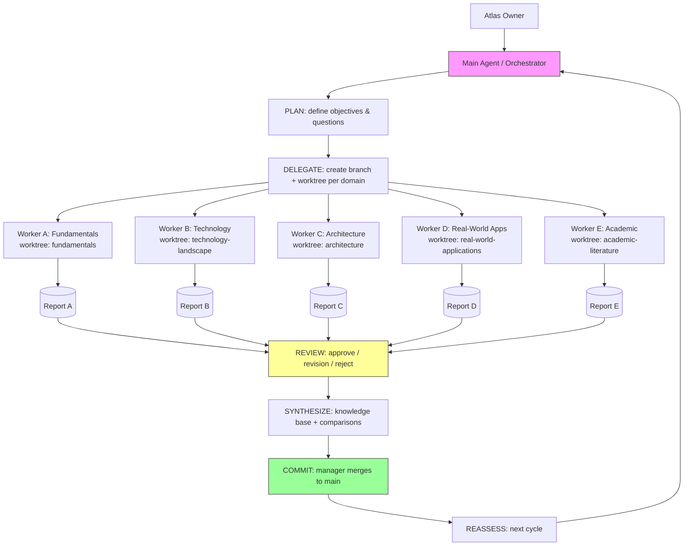

# Agent H Report — Cycle 2 Architecture Deep-Dive

## Orchestrator-Worker Pattern Detailed Analysis

### How it works
The orchestrator-worker pattern uses a lead agent (orchestrator) that decomposes a task into subtasks, delegates them to specialized subagents (workers) operating in parallel, and synthesizes their results into a final output. Each worker receives an objective, output format, tool/source guidance, and clear task boundaries. Workers operate with bounded context and do not coordinate directly with each other; all information flows through the orchestrator.

**Classification:** FACT
**Source:** Anthropic Engineering, "How we built our multi-agent research system", 2025-06-13 — https://www.anthropic.com/engineering/built-multi-agent-research-system

### Delegation mechanics
The orchestrator analyzes the input, develops a strategy, and spawns workers to explore different aspects simultaneously. Workers act as intelligent filters, iteratively using tools to gather information and returning lightweight references to the coordinator rather than full context.

**Classification:** FACT
**Source:** Anthropic Engineering, 2025-06-13

### Synthesis
The orchestrator collects worker outputs and synthesizes them into a coherent whole. This creates a potential bottleneck: the orchestrator cannot steer workers mid-execution, workers cannot coordinate, and information flow is centralized.

**Classification:** FACT (behavior), INTERPRETATION (bottleneck characterization)
**Source:** Anthropic Engineering, 2025-06-13

## Git Worktree as Isolation Primitive

### What it does
`git worktree add` checks out a branch into a separate physical directory while sharing the object database with the main repository. Each worktree is an independent working directory on its own branch.

**Classification:** FACT
**Source:** Git documentation, git-worktree — https://git-scm.com/docs/git-worktree

### Feasibility as agent isolation
Worktrees provide strong filesystem isolation: each agent works in its own directory on its own branch, so agents cannot overwrite each other's files. The main branch stays clean while research is underway. Multiple agents can work in parallel without file conflicts.

**Classification:** FACT (mechanism), INTERPRETATION (suitability for agent isolation)

### Limitations
1. **Framework mismatch:** Most LLM orchestration frameworks (LangGraph, ADK, AutoGen) assume in-process or cloud-deployed agents sharing memory/state, not isolated filesystem worktrees. Adapting them to a worktree model requires custom glue code.
2. **CLI complexity:** Worktrees are a Git concept, not an agent concept. Non-technical users and most agent frameworks do not natively understand them.
3. **Merge conflicts:** When agents' work converges, merging branches can produce conflicts that require human resolution.
4. **No built-in agent lifecycle:** Git does not manage agent startup, shutdown, health, or result collection.

**Classification:** INTERPRETATION

## Combined Architecture Model (Mermaid)

## Scalability Analysis

| Factor | Impact | Mitigation |
|--------|--------|------------|
| Agent count | More agents = more parallelism but more coordination overhead and token cost | Limit to independent domains; don't force parallelism on sequential tasks |
| Coordination overhead | Orchestrator becomes bottleneck; workers can't coordinate directly | Keep delegation lightweight; summarize worker outputs |
| Token cost | Multi-agent systems use ~15× more tokens than single chat | Select cheaper models where quality permits; limit turns |
| Context-window bounds | Long threads risk context loss | Persistent knowledge base; summarize between phases |
| DAG trace debugging | Multi-agent traces are DAGs, not trees; harder to debug | Structured logging; checkpoints |

**Sources:** Anthropic Engineering, 2025-06-13; HLD Handbook, 2026-05-11; Azure AI patterns, 2026-02-12.

## Failure Modes and Mitigations

| Failure mode | Trigger | Impact | Mitigation |
|--------------|---------|--------|------------|
| Worktree divergence | Agent's branch diverges from main | Merge conflicts | Frequent rebase/merge; manager reviews before merge |
| Agent produces no output | Agent fails silently | Missing domain coverage | Completion criteria; manager follow-up |
| Conflicting findings | Two workers reach contradictory conclusions | Synthesis difficulty | Manager flags contradictions; expansion task |
| Context loss | Long research thread | Incoherent output | Summarize; persistent knowledge base |
| Infinite loop | Agent keeps calling tools | Token burn | Iteration limits; timeouts |

**Source:** Azure AI Agent design patterns, 2026-02-12 (iteration limits).

## Human-in-the-Loop Integration

The manager reviews each worker report before integration (APPROVED / REVISION REQUIRED / REJECTED). This is the human-in-the-loop gate. Workers must never commit, merge, or push — only the manager performs Git integration.

**Classification:** PROPOSAL (Atlas project convention)

## Feasibility Assessment Table

| Dimension | Assessment | Evidence | Confidence |
|-----------|-----------|----------|------------|
| Orchestrator-worker for research | Proven pattern for parallel research | Anthropic 2025-06-13 | High |
| Git worktrees as agent isolation | Technically feasible; framework mismatch requires glue | git-scm.com; cycle 1 implementation | Medium-High |
| Combining both | No existing open-source tool does this; custom integration needed | Cycle 1 gap analysis | Medium |
| Scalability to N domains | Linear in agent count; token cost grows | Anthropic 2025-06-13 | Medium |
| Human review gate | Proven in cycle 1 | Cycle 1 execution | High |

## Recommendations

1. Adopt orchestrator-worker with git-worktree isolation as the core model (validated by cycle 1).
2. Build custom glue to connect agents to worktrees (frameworks assume in-process agents).
3. Keep worker count moderate to control token cost.
4. Maintain the manager review gate as the human-in-the-loop.
5. Use persistent knowledge base to mitigate context loss.

## Open Questions

- What is the optimal worker count before coordination overhead dominates?
- How to evaluate research-report quality reliably at scale without excessive LLM-as-judge cost?
- Which framework (if any) best bridges the worktree isolation model?

## Sources
- Anthropic Engineering, "How we built our multi-agent research system", 2025-06-13 — https://www.anthropic.com/engineering/built-multi-agent-research-system
- Git documentation, git-worktree — https://git-scm.com/docs/git-worktree
- HLD Handbook, "Multi-Agent Orchestration", 2026-05-11 — https://hld.handbook.academy/curriculum/ai-ml-system-design/multi-agent-orchestration
- Azure AI Agent design patterns, 2026-02-12 — https://learn.microsoft.com/en-us/azure/architecture/ai-ml/guide/ai-agent-design-patterns
- MDPI Systems survey, Zhu et al., 2026-06-01 — https://www.mdpi.com/1999-5903/18/6/326
