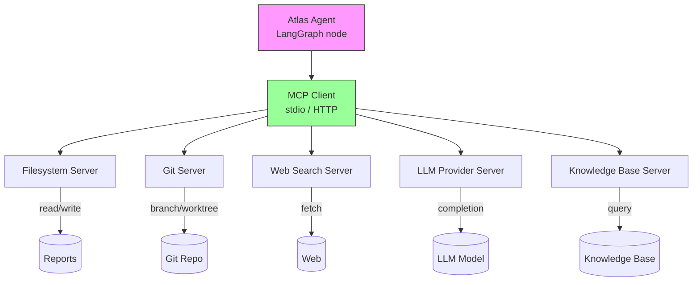

# Agent O Report — Cycle 3 MCP Integration

## Objective
Design the Model Context Protocol (MCP) integration for Project Atlas: which MCP servers agents need, how they connect, and an implementation plan.

## Context
Cycle 2 recommended adopting MCP for agent tool access (search, git, LLM APIs) and deferring A2A. Cycle 3 specifies the MCP integration design.

## MCP Servers Required by Atlas

| Server | Purpose | Tools exposed | Status |
|--------|---------|---------------|--------|
| Filesystem | Read/write reports, knowledge base, assignments | read_file, write_file, list_directory | Build (custom) |
| Git | Branch, worktree, commit, status, diff | git_branch, git_worktree_add, git_commit, git_diff | Build (custom) |
| Web search | Information gathering for agents | web_search, fetch_page | Third-party (existing) |
| LLM provider | Call LLM APIs for agents | llm_completion | Third-party / build |
| Knowledge base | Query synthesized findings | kb_search, kb_get | Build (custom) |

## MCP Architecture (Mermaid)

## Connection Model
- **Transport:** stdio for local servers (filesystem, git, KB); HTTP for remote servers (web search, LLM provider)
- **Discovery:** Agent discovers available tools via MCP `tools/list` at startup
- **Invocation:** Agent calls `tools/call` with tool name and arguments
- **Sandboxing:** Each agent gets its own MCP client session scoped to its worktree (filesystem server restricted to that directory)

## Implementation Plan

| Phase | Task | Description |
|-------|------|-------------|
| 1 | Filesystem server | read_file, write_file, list_directory scoped to agent worktree |
| 2 | Git server | git_branch, git_worktree_add, git_status, git_diff (read-only commit for manager) |
| 3 | Web search server | web_search, fetch_page using existing search provider |
| 4 | Knowledge base server | kb_search, kb_get over docs/knowledge-base |
| 5 | LLM provider server | llm_completion with provider abstraction |
| 6 | Agent integration | LangGraph nodes call MCP tools via client session |

## Security Considerations
- **Filesystem sandboxing:** Restrict filesystem server to the agent's assigned worktree; prevent access to other worktrees or main outside allowed paths
- **Git restrictions:** Agents can create branches/worktrees but cannot commit or push (manager owns Git integration)
- **Secret handling:** No API keys or secrets exposed to MCP servers; LLM provider credentials managed by orchestrator, not agents
- **Tool output sanitization:** Sanitize tool outputs before feeding back to agents (prompt injection protection)

## Risks and Mitigations

| Risk | Mitigation |
|------|------------|
| MCP server immaturity | Build minimal custom servers; use third-party only for search/LLM |
| Prompt injection via tool output | Sanitize all tool outputs; limit agent tool scope |
| Agent accessing unauthorized paths | Worktree-scoped filesystem server |
| Server downtime blocks agents | Fallback: direct function calls for critical tools |

## Success Criteria
- MCP server list defined with purposes and tools
- Connection model (transport, discovery, invocation) specified
- Security model (sandboxing, restrictions, secrets) defined
- Implementation plan with 6 phases
- Risks and mitigations identified

## Open Questions
- Which MCP client library for Python (official SDK vs community)?
- Should the git server allow agent commits, or keep all Git in the manager?
- How to handle MCP server versioning as the protocol evolves?

## Sources
- Model Context Protocol — https://mcp.so (2025-2026)
- MDPI Systems survey, Zhu et al., 2026-06-01 — https://www.mdpi.com/1999-5903/18/6/326
- Agent J Report — Cycle 2 Integration Protocols (this repo)
