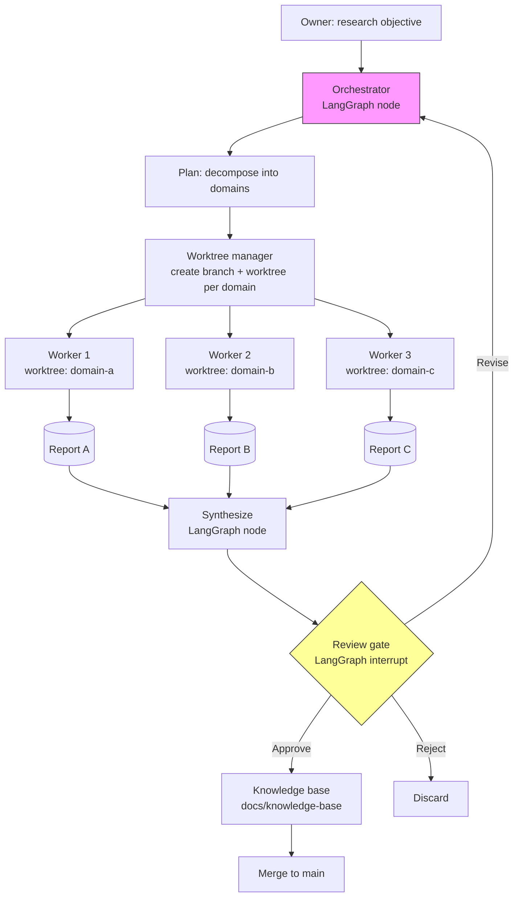

# Agent M Report — Cycle 3 Prototype Design

## Objective
Produce a detailed implementation specification for a feasibility prototype of Project Atlas's core model: orchestrator-worker orchestration with git-worktree agent isolation, using LangGraph as the orchestration framework.

## Context
Cycle 2 recommended LangGraph as the primary orchestration framework (graph model, persistence via checkpoints, native human-in-the-loop interrupts) and git worktrees for agent isolation. No existing open-source tool combines these. Cycle 3 designs the prototype that validates this combination.

## Prototype Architecture Specification

### Core components
| Component | Responsibility | Technology |
|-----------|---------------|------------|
| Orchestrator | Decomposes research objectives, delegates to workers, synthesizes results | LangGraph node |
| Workers | Execute independent research domains in isolated worktrees | LangGraph nodes + git worktrees |
| Worktree manager | Creates/deletes worktrees, tracks branch↔worktree mapping | Python + git CLI |
| Knowledge base | Stores synthesized findings (markdown, CSV, JSON) | Filesystem (docs/) |
| Review gate | Manager APPROVED / REVISION REQUIRED / REJECTED decision | Human-in-the-loop (LangGraph interrupt) |

### Data flow (Mermaid)

### Orchestrator-worker graph (LangGraph StateGraph)
- **State:** `research_objective`, `domains[]`, `worktrees[]`, `reports[]`, `synthesis`, `review_status`, `current_phase`
- **Nodes:**
  1. `plan`: decompose objective into research domains
  2. `delegate`: call worktree manager to create branch+worktree per domain
  3. `investigate`: (worker executes in worktree; represented as state transition)
  4. `report`: worker returns report to orchestrator
  5. `synthesize`: combine reports into knowledge-base entries
  6. `review`: LangGraph interrupt — human manager APPROVES / requests REVISION / REJECTs
  7. `commit`: manager merges approved branch to main
- **Edges:** plan → delegate → investigate → report → synthesize → review → (approve → commit → end; revise → investigate; reject → end)

### Worktree manager (Python + git CLI)
Responsibilities:
- `create_worktree(domain, branch_name)` → returns worktree path
- `list_worktrees()` → active worktrees
- `remove_worktree(domain)` → cleanup after merge
- `get_branch(domain)` → assigned branch name

### Human-in-the-loop (LangGraph interrupt)
Use LangGraph's `interrupt()` before the commit step. The manager reviews the synthesized output and:
- APPROVED → proceed to commit
- REVISION REQUIRED → route back to investigate with feedback
- REJECTED → terminate cycle for that domain

## Prototype Scope (MVP)
- In-scope: orchestrator graph, worktree manager, review gate, knowledge-base output, single research cycle with 3-5 domains
- Out-of-scope: MCP integration, A2A, multi-provider LLM routing, web UI, scheduled/long-running workflows

## Tech Stack
| Layer | Choice | Rationale |
|-------|--------|-----------|
| Language | Python | Dominant agent/LLM library support |
| Orchestration | LangGraph | Graph model, checkpoints, interrupts |
| LLM provider | Anthropic Claude (primary) | Cycle 1/2 sources; strong research capability |
| Version control | Git + worktrees | Agent isolation, clean main |
| Output format | Markdown / CSV / JSON | Research knowledge base |
| CLI | Click or Typer | Operator interface |

## Implementation Phases
1. **Phase 1:** Worktree manager + orchestrator skeleton (plan/delegate/report)
2. **Phase 2:** Review gate (LangGraph interrupt) + knowledge-base writer
3. **Phase 3:** End-to-end cycle with 3 domains; manager review
4. **Phase 4:** Cost/token logging; feasibility assessment

## Success Criteria
- Prototype executes one full research cycle (plan → delegate → investigate → report → review → commit)
- Each domain isolated in its own worktree on its own branch
- Manager can approve/revise/reject via LangGraph interrupt
- Approved work merges cleanly to main
- Token cost logged per cycle

## Open Questions
- How to represent worker investigation (external process vs in-process node) given worktree isolation?
- How to persist state across separate worktree executions?
- What is the minimal viable worker interface?

## Sources
- LangGraph documentation — https://langchain.com (2026)
- Azure AI Agent design patterns — https://learn.microsoft.com/en-us/azure/architecture/ai-ml/guide/ai-agent-design-patterns, 2026-02-12
- Git documentation, git-worktree — https://git-scm.com/docs/git-worktree
- Agent H Report — Cycle 2 Architecture Deep-Dive (this repo)
- Agent I Report — Cycle 2 Technology Comparison (this repo)
